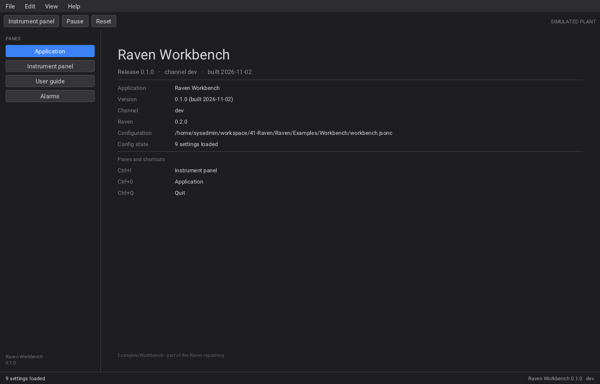
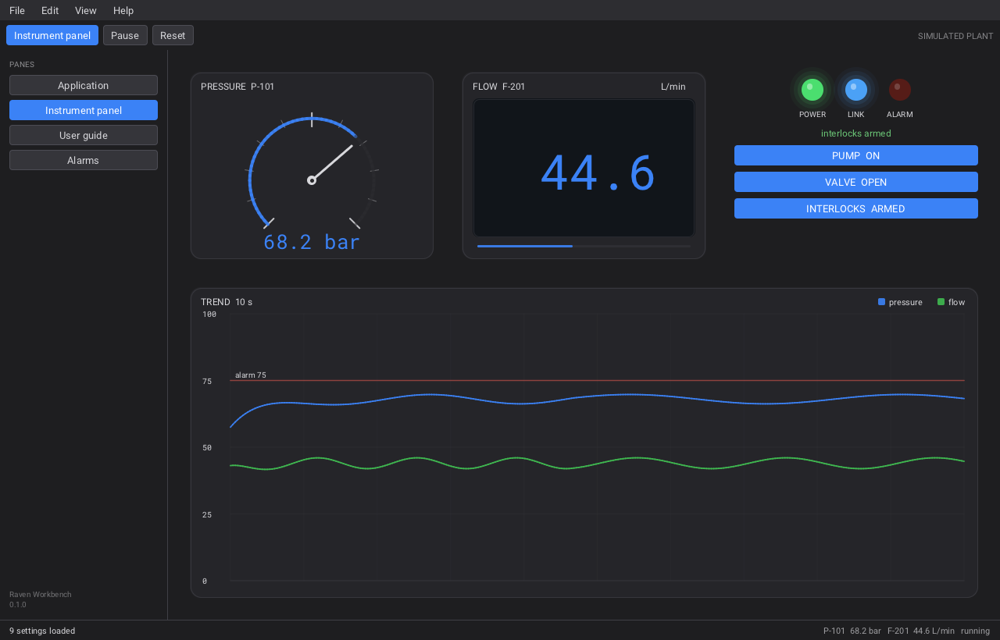
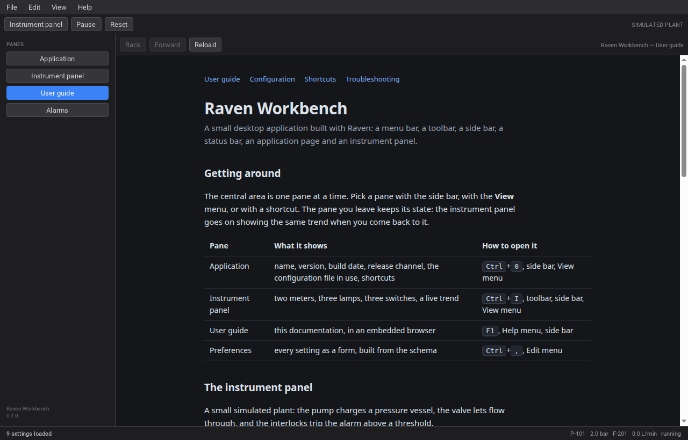
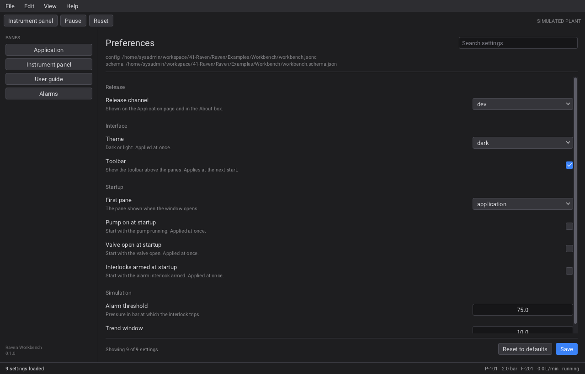
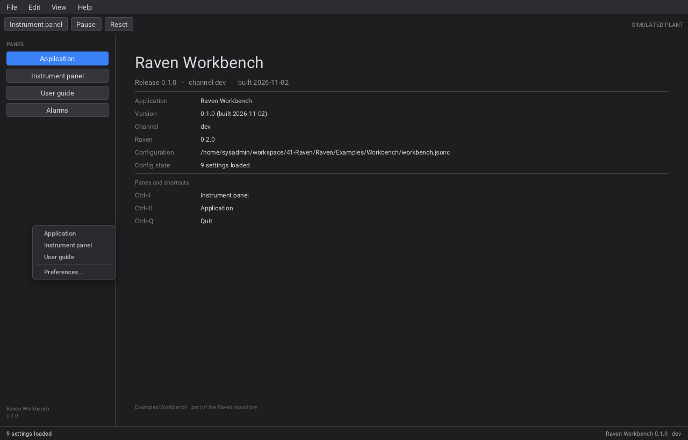
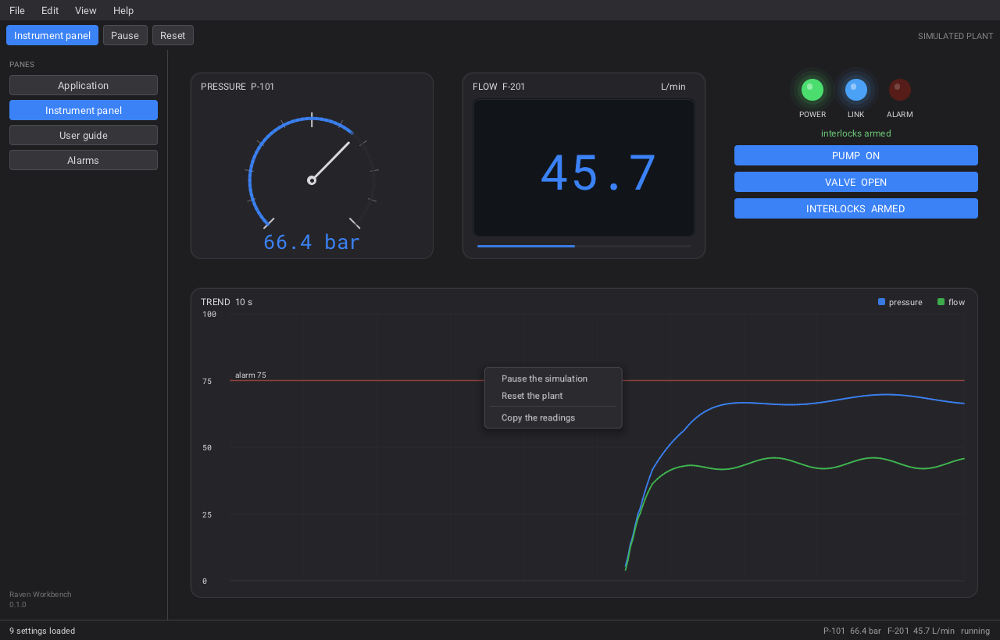
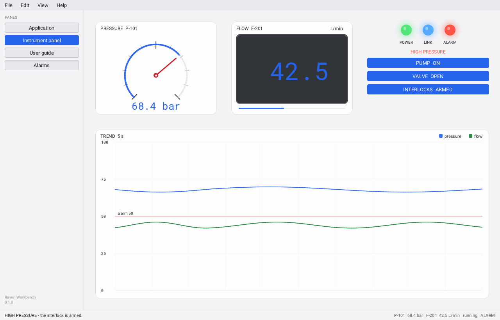

# Workbench

A desktop application shell: a menu bar, a toolbar, a side bar, a status bar,
and a central pane that switches between an **Application** page and the
instrument panel kept in `cpp/panel/` (the same pane as Raven's InstrumentPanel example).

Configuration comes from a **JSONC** file (JSON with comments), so a build can
ship defaults and a user can turn features on and off without a recompile.

> Extending it? [`DESIGN.md`](DESIGN.md) has the architecture and the recipes;
> [`AGENTS.md`](AGENTS.md) is the build/test hand-off and the forking checklist.















---

## What it demonstrates

| Piece | How |
|---|---|
| **Menu bar** | `MenuBar` with File / View / Help; items name **actions** (`Rwidget_set_action`), so the menu, the toolbar and shortcuts share one handler |
| **Checkable items** | View > Application and View > Instrument panel keep their own check marks; the handler reads the item |
| **Toolbar** | an `HBox` of buttons, optional — `"ui": { "toolbar": false }` removes it |
| **Side bar** | fixed-width `VBox` listing the panes; the active one is highlighted |
| **Central pane** | a `Switcher`: page 0 the Application page, page 1 the instrument panel. Neither is rebuilt when shown |
| **Application page** | name, version, build date, release channel, Raven version, the configuration file and its state, shortcuts |
| **Status bar** | the last command or the configuration state on the left, live plant values on the right |
| **Documentation pane** | a `WebView` (`raven_web`) embedded in the Switcher: Help > User guide (F1), with back / forward / reload |
| **Embedded browser** | `raven_web` drives an installed Chromium-family browser headlessly and shows the page as a texture; the guide is local HTML |
| **Configuration** | JSONC, applied at startup: theme, toolbar, startup pane and switches, alarm threshold, trend window |
| **Preferences editor** | Edit > Preferences (Ctrl+,): the settings as a form, built from `workbench.schema.json` - groups, titles, descriptions, check boxes, combo boxes, spin boxes, search |
| **JSON Schema** | `workbench.schema.json` (2020-12) describes every key; the editor reads its subset to build itself, and the same file guides editors and validators |
| **Context menus** | right-click the side bar or any pane: the same actions as the menu bar, plus copy-to-clipboard |

A hidden pane costs nothing: the frame callback returns before simulating or
requesting a redraw, and the panel keeps its history, switch positions and
animation state.

```
┌──────────────────────────────────────────────────────────────┐
│ File   View   Help                                           │  menu bar
├──────────────────────────────────────────────────────────────┤
│ [Instrument panel] [Pause] [Reset]            SIMULATED PLANT│  toolbar (optional)
├──────────┬───────────────────────────────────────────────────┤
│ PANES    │                                                   │
│ Applic.  │       the central pane: a Switcher                │
│ Panel    │       page 0: Application information             │
│ Alarms   │       page 1: the instrument panel                │
│          │                                                   │
├──────────┴───────────────────────────────────────────────────┤
│ 9 settings loaded                 P-101 66.6 bar … running   │  status bar
└──────────────────────────────────────────────────────────────┘
```

---

## Documentation pane

**Help > User guide** (<kbd>F1</kbd>) opens the documentation as a third pane. It
is a real `WebView` from `raven_web`: an installed Chromium-family browser
(Chrome, Chromium, Edge, Brave) runs headless, Raven receives the picture of the
page and shows it as a texture, clipped and scrolled like any other widget.
Clicks, keys and scrolling go back to the page, so its links work.

The pane has its own small toolbar: **Back**, **Forward** (disabled when there is
nowhere to go) and **Reload**, plus the title of the page.

The pages live in [`help/`](help): `index.html` (the user guide) and
`configuration.html`, sharing `style.css`. They are found through
`WORKBENCH_HELP_DIR`, compiled in at build time. The application passes its
theme in the URL (`?theme=dark`), so the guide matches the window instead of the
desktop preference; each page keeps it on its links.

Without a browser the view says so (`Rweb_view_get_error`) and the pane still
opens: reload, the links between the pages, and the rest of the application keep
working. `Rweb_is_available()` tells an application what to expect.

To ship it: install `help/` next to the binary and point `WORKBENCH_HELP_DIR` at
that folder (`install(DIRECTORY help DESTINATION share/workbench)`).

---

## Preferences

**Edit > Preferences** (<kbd>Ctrl</kbd>+<kbd>,</kbd>) opens the settings as a form,
in the style of an editor's settings page: a search field, one row per setting
with its title and description, and a control of the right type on the right.

| Type in the schema | Control |
|---|---|
| `boolean` | check box |
| `string` with `enum` | combo box |
| `number` / `integer` with `minimum`/`maximum` | spin box with that range |
| any other `string` | text field |

Changes are applied at once where that is possible (theme, alarm threshold,
trend window, the three switches) and marked "not saved yet" in the status bar.
**Save** writes the configuration file **in place**: only the values change, so
the comments, the blank lines and the layout around them stay exactly as they
were written. A key the file does not have is added to its object. A file with a
syntax error is not overwritten - the status bar says why. **Reset to defaults**
puts the defaults back in memory. The toolbar and the first pane are read at
startup, so the pane says so after saving.

A key that the schema lists but this build does not use shows
"not used by this build" instead of a control: the form never lies about what it
can change.

---

## Context menus

Right-click the side bar or any pane:

| Where | Menu |
|---|---|
| Side bar | Application · Instrument panel · User guide · — · Preferences… |
| Application page | User guide · Preferences… · — · Copy version · Copy configuration path |
| Instrument panel | Pause the simulation · Reset the plant · — · Copy the readings |
| Preferences | Save · Reset to defaults · — · Copy configuration path |
| User guide | Back · Forward · Reload · — · Preferences… |

Two details make this work:

* a menu is attached with `Rwidget_set_context_menu`, and Raven walks **up** from
  the widget under the pointer - so a menu on a pane is the menu of everything
  inside it: a label, a tile, the gauge, the chart;
* a panel is transparent to the pointer by default (its class sets `NO_HIT`), so
  the areas that show a menu are made hit-testable with `Rwidget_set_hit_testable`.
  Their children still take the clicks first.

Every entry is an **action** - the same names the menu bar and the toolbar fire -
so a context menu can never disagree with them. The "Copy …" entries write to the
clipboard with `Rclipboard_set_text`.

---

## The schema

[`workbench.schema.json`](workbench.schema.json) is a
[JSON Schema 2020-12](https://json-schema.org/draft/2020-12/schema) document that
describes the configuration file: the same groups, keys, types, choices, ranges
and defaults the application uses.

```json
{
	"$schema": "https://json-schema.org/draft/2020-12/schema",
	"$id": "https://github.com/.../workbench.schema.json",
	"title": "Raven Workbench settings",
	"type": "object",
	"additionalProperties": false,
	"properties": {
		"simulation": {
			"title": "Simulation",
			"type": "object",
			"properties": {
				"alarm_limit": {
					"title": "Alarm threshold",
					"description": "Pressure in bar at which the interlock trips.",
					"type": "number",
					"minimum": 10,
					"maximum": 100,
					"default": 75
				}
			}
		}
	}
}
```

**How the application uses it.** `schema.cpp` parses the document with the same
JSONC reader as the settings, into groups of `SchemaSetting` (path, title,
description, type, choices, range, default). The Preferences pane
(`preferences.cpp`) builds itself from that list: it iterates the groups, adds a
header, and one row per setting with the control chosen by type. Values are read
and written through `config_get` / `config_set`, keyed by the dotted path
(`simulation.alarm_limit`) - so a setting goes from the schema to a working
control without a line of UI code.

**Which part of JSON Schema is understood.** The editor reads `properties`
(nested one level: groups), `title`, `description`, `type` (`boolean`, `string`,
`number`, `integer`), `enum`, `minimum`, `maximum` and `default`. Everything else
in the file is for editors and validators: `$schema`, `$id`, and
`additionalProperties: false` make it a valid schema that VS Code, `check-jsonschema`,
or any validator can use against `workbench.jsonc`. Values are clamped to
`minimum`/`maximum` by `config_set`, so the form cannot write an invalid file.

**Saving keeps the file as written.** `config_save` parses the file, then
replaces the *literal* of each setting using the offsets the reader recorded
(`Json::start` / `Json::end`); comments, blank lines and alignment are untouched.
A key that is absent is inserted before the closing brace of its object. The
result is parsed again before it is written, so a bad edit can never corrupt the
file.

**Adding a setting.** Add it to `workbench.jsonc`, to the schema (with title,
description, type and default), to `Config` and to `config_get`/`config_set`.
The Preferences pane picks it up on the next start; no widget code is needed.

---

## Configuration

`workbench.jsonc` sits next to this README. It is found in this order:

1. `--config <path>` on the command line,
2. the `WORKBENCH_CONFIG` environment variable,
3. the file next to the source, compiled in at build time.

Every key is optional. A missing key, a wrong type, or a file that cannot be
read leaves the default in place; a syntax error is reported in the
Application page and the status bar, and the defaults are used.

```jsonc
{
	// shown in the Application page and the About box
	"release": { "channel": "dev" },

	"ui": {
		"theme": "dark",          // "dark" or "light"
		"toolbar": true           // false hides the toolbar
	},

	"startup": {
		"pane": "application",    // "application" or "instrument-panel"
		"pump": false,            // the panel's switches at startup
		"valve": false,
		"armed": false
	},

	"simulation": {
		"alarm_limit": 75,        // bar, the interlock threshold (10..100)
		"chart_seconds": 10       // trend window in seconds (1..10)
	}
}
```

| Key | Type | Default | Effect |
|---|---|---|---|
| `release.channel` | string | `dev` | shown in the Application page, the title of the status bar and About |
| `ui.theme` | `dark` \| `light` | `dark` | applied before the window is built |
| `ui.toolbar` | boolean | `true` | `false` builds the window without the toolbar (the View menu still has Pause and Reset) |
| `startup.pane` | `application` \| `instrument-panel` | `application` | the page shown at startup |
| `startup.pump` / `valve` / `armed` | boolean | `false` | the panel's switches, so the plant runs from the first frame |
| `simulation.alarm_limit` | number | `75` | the interlock threshold: needle colour, alarm lamp, chart line |
| `simulation.chart_seconds` | number | `10` | how much history the trend shows |

The reader is `config.h` / `config.cpp`: a small recursive-descent JSONC parser
(~300 lines) with `//` and block comments, trailing commas and `\u` escapes.
No dependency, and the error message carries the line number.

---

## Files

| File | Contains |
|---|---|
| [`cpp/main.cpp`](cpp/main.cpp) | the shell: menus, toolbar, side bar, Switcher, status bar, Application page, actions, tests |
| [`cpp/json.h`](cpp/json.h) / [`cpp/json.cpp`](cpp/json.cpp) | the JSONC reader |
| [`cpp/config.h`](cpp/config.h) / [`cpp/config.cpp`](cpp/config.cpp) | the settings, their defaults, and reading/writing the file |
| [`cpp/schema.h`](cpp/schema.h) / [`cpp/schema.cpp`](cpp/schema.cpp) | the schema reader |
| [`cpp/preferences.h`](cpp/preferences.h) / [`cpp/preferences.cpp`](cpp/preferences.cpp) | the Preferences pane |
| [`workbench.jsonc`](workbench.jsonc) | the shipped configuration (all defaults) |
| [`workbench.schema.json`](workbench.schema.json) | the JSON Schema the Preferences pane is built from |
| [`help/`](help) | the user guide: `index.html`, `configuration.html`, `style.css` |
| [`cpp/panel/panel.h`](cpp/panel/panel.h) / `panel.cpp` | the pane: instruments, lamps, chart, simulated plant |
| [`cpp/CMakeLists.txt`](cpp/CMakeLists.txt) | version, build date, configuration path, and the panel module |

---

## Build and run

Raven is the only dependency, and it is not vendored. Either install it (the
`raven-dev` package, or `cmake --install build` of a checkout), or point the
build at a checkout:

```bash
cd cpp
cmake -S . -B build                                   # Raven installed
# or: cmake -S . -B build -DRAVEN_SOURCE_DIR=/path/to/Raven

cmake --build build
ctest --test-dir build --output-on-failure            # or ./build/workbench --test

./build/workbench                              # the application
./build/workbench --config mine.jsonc          # another configuration
./build/workbench --test                       # no window, no GPU
./build/workbench --capture app.ppm --pane application
./build/workbench --capture panel.ppm --pane instrument-panel
./build/workbench --capture menu.ppm --menu   # with a context menu open
```

The screenshots above were made with `--capture`, the configured one with
`--config` pointing at a file that sets `theme`, `toolbar`, `pane`,
`alarm_limit` and `chart_seconds`.

---

## What `--test` checks

```
workbench: 0 checks failed, 65 samples, config 8 settings loaded
PASS
```

* the JSONC reader: comments, trailing commas, every key, the settings count, a
  syntax error (reported, defaults kept) and a missing file (not an error);
* the default application: the Application page is shown, the toolbar exists,
  the version/channel/configuration labels carry the right values;
* the toolbar opens the panel and the side bar goes back; the View actions do
  the same, with the menu item as the sender;
* a hidden pane does not simulate, and its trend survives being shown again;
* Pause and Reset work, and the status bar names the last command;
* a configured application: no toolbar, the panel open at startup, the theme,
  alarm limit, trend window and switches taken from the file, the channel and
  settings count shown in the Application page, and the configured pump raising
  the pressure by itself.
* the documentation pane: Help > User guide selects it, the WebView exists, and
  the side bar goes back. The test points the browser at a missing program
  (`Rweb_set_browser_path`) so it never starts one: the pane is tested, not the
  browser. The screenshots were made with Chrome.
* the preferences pane: the schema loads with four groups and nine settings,
  Edit > Preferences opens it, every setting has a row, the search filters
  (and clears), a control changes the setting when clicked, Save writes the file
  and it reads back with the change, and Reset restores the defaults;
* saving a hand-written file keeps its comments (line and inline), replaces only
  the values, adds a key that was missing, and the result reads back with the
  new settings;
* the context menus: a right-click on the side bar opens its menu, its first
  entry shows the Application pane, Escape closes a menu, a right-click on the
  panel opens its menu and pauses the plant, and Copy version reaches the
  clipboard.

---

## Extending it

| Idea | How |
|---|---|
| More panes | add a page to the Switcher and a button + menu item that selects it |
| Dockable panes | replace the side bar + Switcher with `DockArea` (`Rdock_area_add_panel`) |
| A settings pane | build sliders/checkboxes from the same `Config`, then write the file back |
| Recent files | a sub-menu built at run time with `Rmenu_add_item` |
| Icons | `Rimage_create` + `Rimage_set_texture` in the toolbar |
| More settings | one key in `config.cpp`, one field in `Config`, one line in the Application page |

The instrument panel is `cpp/panel/`; the standalone `Examples/InstrumentPanel`
example uses the same code and explains the paint callbacks behind the gauge,
the meter, the lamps and the chart.
